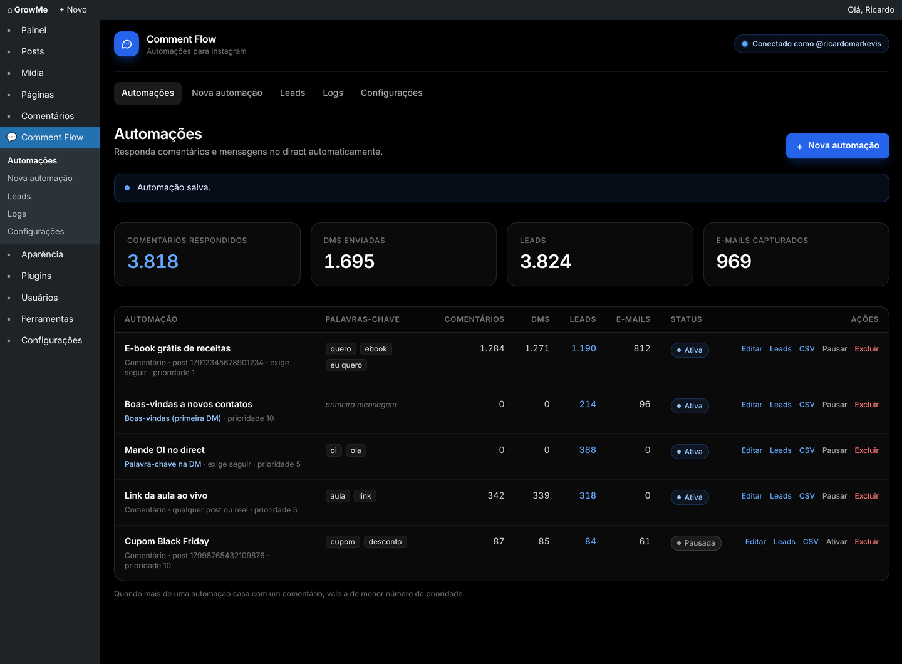
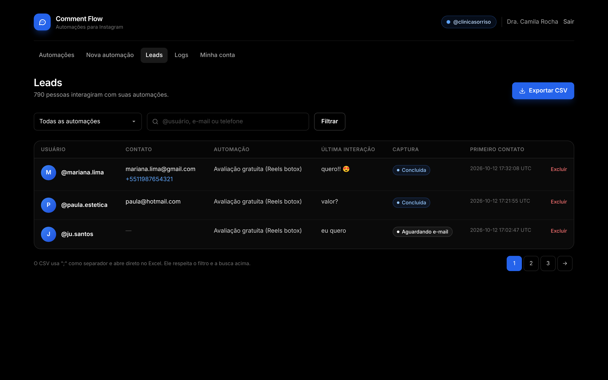
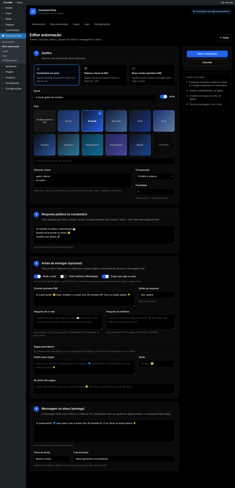
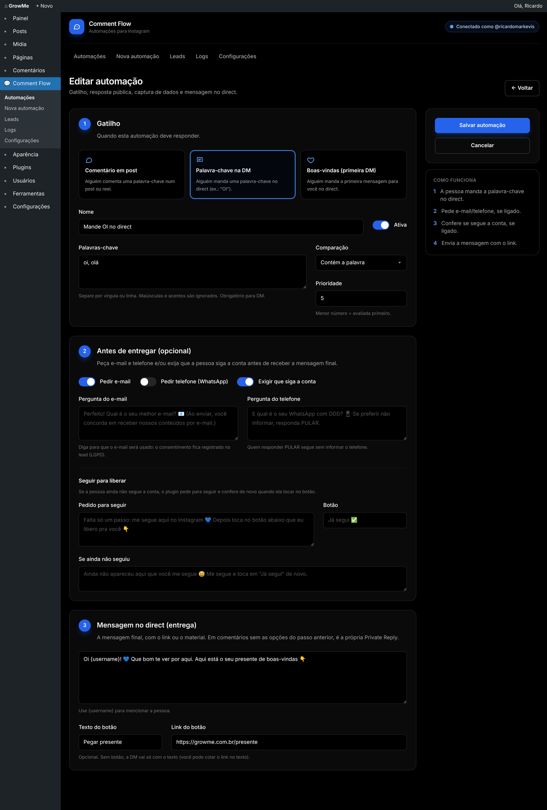
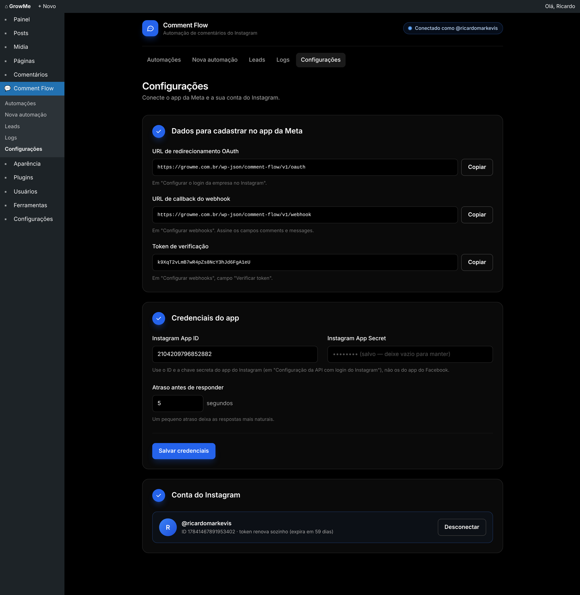

# Comment Flow

Plugin WordPress de automações para Instagram, no estilo ManyChat, tudo pela API oficial da Meta. Ele responde comentários por palavra-chave com DM (Private Reply), responde palavras-chave e a primeira mensagem no direct, exige que a pessoa siga a conta antes de liberar o link ("seguir para liberar"), captura e-mail e telefone e exporta os leads em CSV.

O plugin está em [`comment-flow/`](comment-flow/). A instalação, a configuração do app na Meta e os detalhes estão no [README do plugin](comment-flow/README.md).

## Telas

| Automações | Leads |
|---|---|
|  |  |

| Automação por comentário | Automação por DM (seguir para liberar) |
|---|---|
|  |  |

| Configurações |
|---|
|  |

## Desenvolvimento

O CSS do painel é feito com Tailwind CSS e já vem compilado em `comment-flow/assets/admin.css`. Para gerar de novo depois de mudar as telas:

```bash
npm install
npm run build:css
```

Para instalar no WordPress, envie só a pasta `comment-flow/` (ou um `.zip` dela). `node_modules`, `package.json` e `docs/` não precisam ir para o site.
