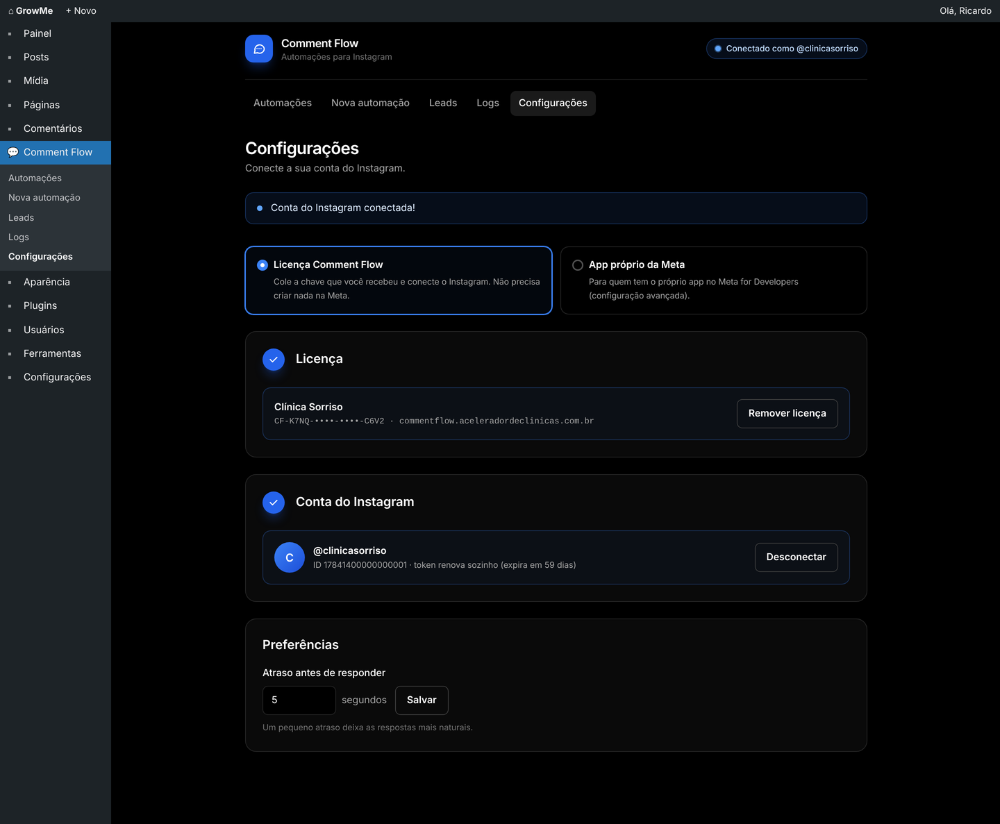
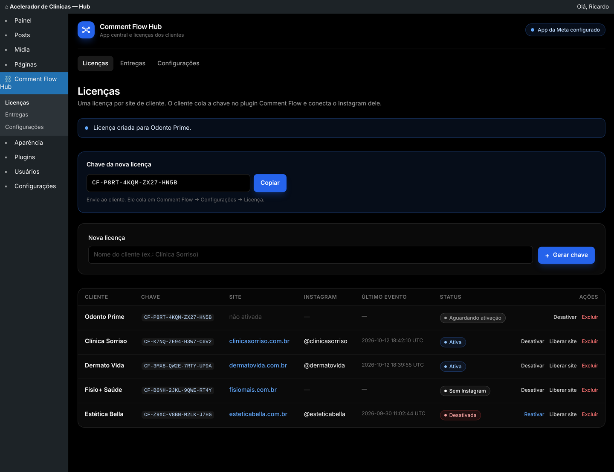

# Comment Flow

Plugin WordPress de automações para Instagram, no estilo ManyChat, tudo pela API oficial da Meta. Ele responde comentários por palavra-chave com DM (Private Reply), responde palavras-chave e a primeira mensagem no direct, exige que a pessoa siga a conta antes de liberar o link ("seguir para liberar"), captura e-mail e telefone e exporta os leads em CSV.

| Pasta | O que é |
|---|---|
| [`comment-flow/`](comment-flow/) | Plugin instalado no site de cada cliente ([README](comment-flow/README.md)) |
| [`comment-flow-hub/`](comment-flow-hub/) | Servidor central: app da Meta, licenças e repasse dos webhooks para os clientes ([README](comment-flow-hub/README.md)) |

## Telas

| Automações | Leads |
|---|---|
|  |  |

| Automação por comentário | Automação por DM (seguir para liberar) |
|---|---|
|  |  |

| Configurações (modo licença) | Hub: licenças dos clientes |
|---|---|
|  |  |

## Desenvolvimento

O CSS do painel é feito com Tailwind CSS e já vem compilado em `comment-flow/assets/admin.css`. Para gerar de novo depois de mudar as telas:

```bash
npm install
npm run build:css
```

Para instalar no WordPress, envie só a pasta do plugin (ou um `.zip` dela): `comment-flow/` nos sites dos clientes e `comment-flow-hub/` no site do hub. `node_modules`, `package.json` e `docs/` não precisam ir para o site.
