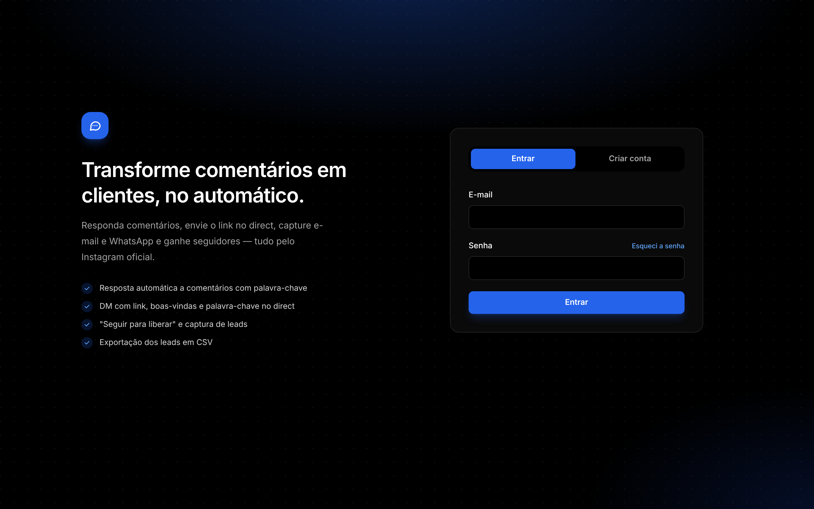
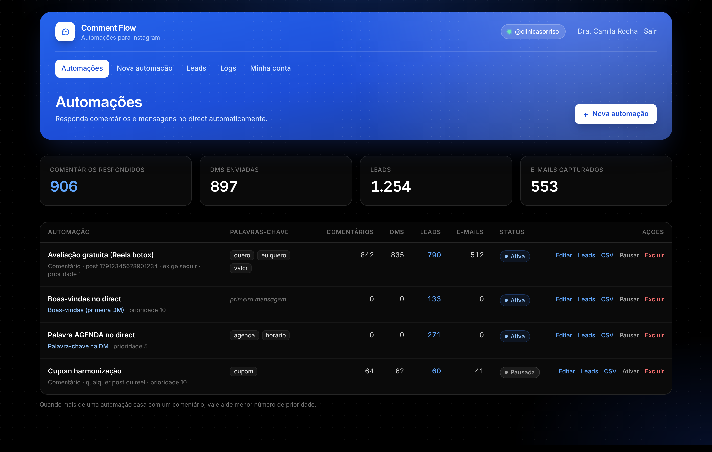
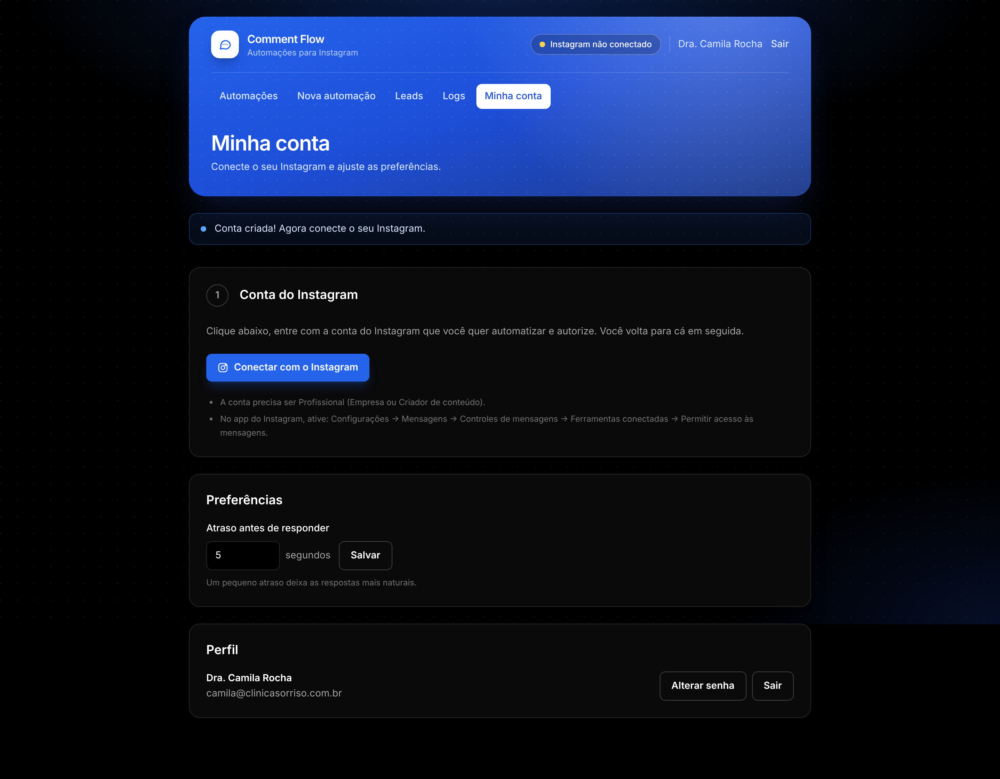
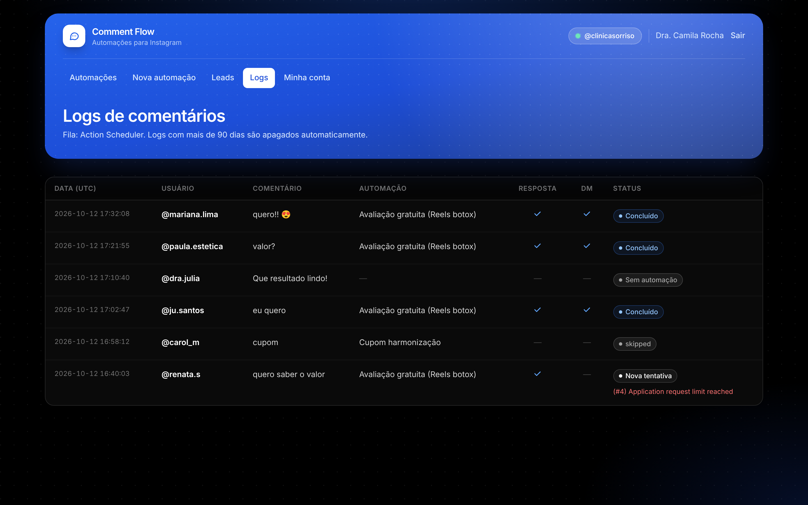
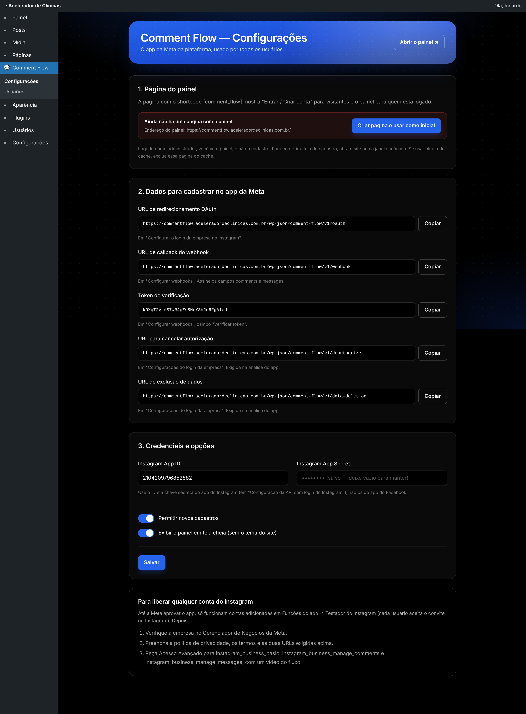
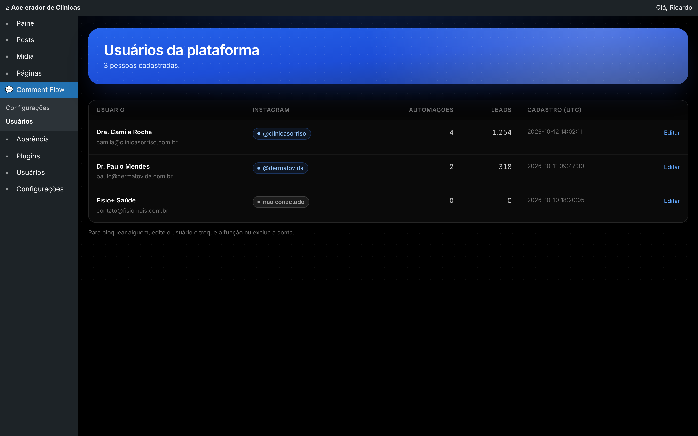

# Comment Flow

Plataforma de automações para Instagram no estilo ManyChat, feita como **um único plugin WordPress** e usando só a API oficial da Meta.

Cada pessoa se cadastra com e-mail e senha, conecta o próprio Instagram em um clique e vê **apenas os seus dados**: automações, leads e logs. O painel fica no front-end do site, na página onde você colocar o shortcode `[comment_flow]` (por exemplo, a home de `commentflow.aceleradordeclinicas.com.br`).

O que o plugin faz:

- responde comentários por palavra-chave e manda DM (Private Reply);
- responde palavras-chave e a primeira mensagem no direct;
- só libera o link para quem segue a conta ("seguir para liberar");
- captura e-mail e telefone;
- exporta os leads em CSV.

| Pasta | O que é |
|---|---|
| [`comment-flow/`](comment-flow/) | O plugin ([README](comment-flow/README.md)) |

## Telas

| Entrar / criar conta | Automações |
|---|---|
|  |  |

| Minha conta (conectar o Instagram) | Leads |
|---|---|
|  |  |

| Editor de automação | Logs |
|---|---|
|  |  |

| wp-admin: configurações da plataforma | wp-admin: usuários |
|---|---|
|  |  |

## Desenvolvimento

O CSS é feito com Tailwind CSS e já vem compilado em `comment-flow/assets/admin.css`. Para gerar de novo depois de mudar as telas:

```bash
npm install
npm run build:css
```

Para instalar no WordPress, envie só a pasta `comment-flow/` (ou um `.zip` dela). `node_modules`, `package.json` e `docs/` não vão para o site.
